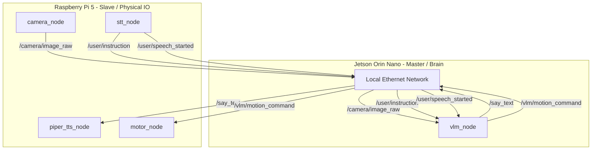

# Education project - Distributed Autonomous Talking Robot

[](https://docs.ros.org)
[](https://www.python.org)
[](https://ollama.com)
[](LICENSE)

---


**Autonomous robot boosted with openVLA / Gemma 3**

The goal of this project is to create a robot capable of interacting with a human and performing actions based on user instructions. The system uses a localized Vision-Language Model (VLM) for scene understanding and decision-making, running entirely on edge hardware.

---

## Hardware Optimization

To ensure fast and reliable inference:
1. **Power Supply**: The Raspberry Pi 5 uses the official 27W (5V/5A) power supply to avoid power-related reboots when driving the motors and USB peripherals simultaneously.
2. **NVMe SSD Storage**: The Jetson Orin Nano boots entirely from a 1TB Crucial NVMe SSD. This drastically increases model loading speeds and prevents I/O bottlenecks when the VLM generates text or swaps memory.

## VLM Latency Optimization

The VLM (Gemma 3 4B QAT served by Ollama on the Jetson Orin Nano 8GB) originally took **~100 s** to answer a voice instruction. Without changing the model, the robot now starts speaking **~2–4.5 s after the instruction is transcribed**. All figures below were measured on the robot's Jetson with real camera frames.

### Where the time goes (one request with a new camera frame)

| Stage | Time | Runs on |
|---|---|---|
| Image preprocessing (decode, resize to 896×896) | ~2 s | CPU |
| Vision encoder (SigLIP, 27 layers) | ~4.6 s | GPU |
| Prompt evaluation (~650 tokens) | ~0.9 s | GPU |
| Answer generation (~45 tokens at ~17 tok/s) | ~2.5 s | GPU |

The image costs far more than the text, so the optimizations below either make the model run at full speed or hide the image encoding behind the time the user spends talking.

### What was changed

| # | Change | Where | Measured effect |
|---|---|---|---|
| 1 | **Keep the whole model on the GPU**: `num_ctx: 2048` and `num_batch: 256` instead of Ollama's 4096/512 defaults. With the defaults the model needed ~6.5 GB but only ~5.7 GB was available, so Ollama silently put 3.3 GB of weights on the CPU. The same options are used by the warm-up and by every request, because any difference makes Ollama reload the model. | `OLLAMA_OPTIONS` in `vlm_node.py` | ~100 s → ~11.5 s per request; generation 7 → 17 tok/s |
| 2 | **No `format: json`**: Ollama's constrained JSON decoding added ~1 s per request on the Orin. The node instead extracts the JSON from the raw answer (it tolerates ` ```json ` fences). | `vlm_node.py` | −1 s |
| 3 | **Lock the clocks with `jetson_clocks`**: with the default governor the CPU often idled at 729 MHz instead of 1.7 GHz, which slowed image preprocessing. | Jetson system setting (see below) | −1.5 s |
| 4 | **Stream the answer and speak early**: the answer is streamed, and `text_response` (the first JSON key) is sent to TTS as soon as its closing quote arrives. The motion command follows when the JSON is complete. | `vlm_node.py` | robot speaks ~2 s before the full answer is ready |
| 5 | **Encode the image while the user is talking**: `stt_node` detects the *start* of speech (energy above threshold for ~0.2 s) and publishes `/user/speech_started`. `vlm_node` then sends the current frame with the fixed part of the prompt to Ollama, which keeps the encoded image in its cache. The transcribed instruction is appended at the *end* of the prompt (`PROMPT_PREFIX`), so the real request reuses the cache and skips the ~6 s image encoding. | `stt_node.py`, `vlm_node.py` | time to speech after transcription: 7.5 s → 4.4 s (instruction 3 s after speech onset) → 2.1 s (6 s after) |

Overall, from the moment the transcription arrives:

| | Robot starts speaking | Full answer (incl. motion) |
|---|---|---|
| Initial | ~100 s | ~100 s |
| After 1–3 | ~9.8 s | ~9.8 s |
| After 4 | ~7.5 s | ~9.6 s |
| After 5 | **~2–4.5 s** | ~4–6.5 s |

With step 5, the longer the user's sentence, the more of the image encoding is already done when it ends. The frame used is the one captured when the user *started* speaking. Only one pre-encode runs at a time, and a pre-encoded frame older than 20 s is ignored.

**Load-time safeguard:** even with these options, the ~1 GB GPU allocation made when Ollama loads the model can fail on the 8GB Orin (`NvMapMemAllocInternalTagged ... error 12` in `journalctl -u ollama`). Ollama then silently keeps part of the model on the CPU, and image requests take minutes or fail with HTTP 500. At startup, `vlm_node` therefore times one request with a camera-sized image (~5–9 s when healthy); if it takes more than 20 s or fails, it unloads and reloads the model, up to 3 attempts, before announcing it is ready.

**Tried without effect:** sending a smaller or larger image (Ollama always resizes to 896×896); reducing `num_ctx` to 1024.

### Making `jetson_clocks` permanent

`sudo jetson_clocks` only lasts until the next reboot. To apply it at boot:

```bash
sudo tee /etc/systemd/system/jetson-clocks.service >/dev/null <<'EOF'
[Unit]
Description=Lock Jetson clocks at maximum
After=nvpmodel.service

[Service]
Type=oneshot
ExecStart=/usr/bin/jetson_clocks

[Install]
WantedBy=multi-user.target
EOF
sudo systemctl enable jetson-clocks.service
```

### Checking the latency in the logs

* Pi: `Speech onset heard, asking the VLM to pre-encode the camera frame`
* Jetson: `Frame pre-encoded while user speaks (x.xs)`, then `Speech ready (x.xs)` when the answer goes to TTS, then `Parsed VLM Response (x.xs)` with the motion command.

### Remaining limits

The vision encoder (~4.6 s on the GPU) is now the main fixed cost of Gemma 3 4B on this board. Going further without a smaller model would mean compiling the vision encoder with TensorRT (e.g. through `jetson-containers`, not yet tested), or moving to a faster Jetson (AGX Orin).

## System Architecture

The robot employs a distributed ROS2 architecture. All USB and GPIO hardware peripherals are connected to the Raspberry Pi 5, leaving the Jetson Orin Nano's resources completely dedicated to running the heavy VLM inference.



### 1. Jetson Orin Nano (Master/Brain)
Runs at full power (MAX-N) to host the Gemma 3:4B VLM. It has no physical peripherals connected to it.
*   **`vlm_node`** (`robot_vlm`): Orchestrates reasoning. When a voice instruction is received over the network, it queries the local Ollama API with the latest camera frame. It parses the JSON output to publish speech to `/say_text` and physical actions to `/vlm/motion_command`. On `/user/speech_started` it pre-encodes the current camera frame so the answer is faster (see [VLM Latency Optimization](#vlm-latency-optimization)).

### 2. Raspberry Pi 5 (Slave/IO)
Connected via Ethernet (sharing `ROS_DOMAIN_ID=42`), this board handles all low-level hardware interaction and physical input/output.
*   **`camera_node`** (`robot_camera`): Captures USB Webcam frames.
*   **`stt_node`** (`robot_audio`): Continuously captures microphone input and transcribes it with Speech Recognition (English, Google Web Speech API). Publishes `/user/speech_started` as soon as the user starts talking.
*   **`piper_tts_node`** (`robot_audio`): Generates natural English speech using the precompiled Piper binary and outputs sound to the USB speaker.
*   **`motor_node`** (`robot_control`): Translates turning angles and distances into wheel ticks/durations, controlling the H-bridge motors via GPIO pins (`rpi-lgpio`).

---

## Wheel Motor Wiring (Raspberry Pi 5 → Cytron MDD20A)

`motor_node` drives the wheels through a **Cytron MDD20A** dual-channel H-bridge in Sign-Magnitude mode (1 PWM + 1 DIR pin per motor). Pin numbers below use Raspberry Pi **BOARD** (physical) numbering and match the `motor_node` ROS2 parameter defaults.

| Signal (ROS2 param) | Pi physical pin | GPIO (BCM) | MDD20A pin |
|---|---|---|---|
| `pwm_left_pin`  | 33 | GPIO13 | `PWM1` |
| `dir_left_pin`  | 29 | GPIO5  | `DIR1` |
| `pwm_right_pin` | 15 | GPIO22 | `PWM2` |
| `dir_right_pin` | 7  | GPIO4  | `DIR2` |
| —               | 6 or 9 (any GND) | GND | `GND` (signal header) |

*   Motor outputs: left motor on `M1A`/`M1B`, right motor on `M2A`/`M2B`.
*   Battery pack (5–30V, matching motor rating) goes to the MDD20A power terminals (`VMS`/`GND`), separate from the Pi's own power supply.
*   Do **not** wire the MDD20A's `5V` signal-header pin back into the Pi — it's a regulator output for external logic, not an input.
*   Pi and driver **GND must be tied together** so the PWM/DIR signals have a common reference, even though power rails are separate.

---

## Package Structure

```
robot_agent_ws/src/
├── robot_bringup/     # Launch files for master and slave configurations
├── robot_camera/      # USB Camera acquisition
├── robot_audio/       # STT (Speech recognition) & TTS (Piper synth + playback)
├── robot_control/     # Kinematics and GPIO motor control
├── robot_vlm/         # Ollama client and reasoning logic
└── robot_ui/          # Web interface
```

---

## Deployment & Running

### Prerequisites

*   **Jetson Orin Nano**: Ubuntu 22.04 + ROS2 Humble, Ollama installed with the `gemma3` model.
*   **Raspberry Pi 5**: Raspberry Pi OS (Debian Trixie) + ROS2 Jazzy, `python3-rpi-lgpio` installed.
*   **Piper Voice**: Download the English model on the Pi:
    ```bash
    cd /home/kant/piper_models
    wget https://huggingface.co/rhasspy/piper-voices/resolve/main/en/en_US/lessac/medium/en_US-lessac-medium.onnx
    wget https://huggingface.co/rhasspy/piper-voices/resolve/main/en/en_US/lessac/medium/en_US-lessac-medium.onnx.json
    ```

### Setup Environment
On both boards, add the following to `~/.bashrc` to enable automatic ROS2 cross-board discovery:
```bash
export ROS_DOMAIN_ID=42
```

### Startup Procedure (Power-On to Launch)

1.  **Power on**: connect the Jetson's power supply and the Pi 5's official 27W USB-C supply. Make sure the motor battery pack is charged and plugged into the Cytron MDD20A (see [Wheel Motor Wiring](#wheel-motor-wiring-raspberry-pi-5--cytron-mdd20a)). Both boards boot headless; allow ~30–60s for boot to complete.

2.  **Connect from your laptop** (two separate SSH sessions, one per board):
    ```bash
    ssh kant@<jetson-host>   # e.g. jetson.local or its static IP
    ssh kant@<pi-host>       # e.g. raspberrypi.local or its static IP
    ```

3.  **Check the network link** between the boards (from either session):
    ```bash
    ping <the-other-board-ip>
    ```

4.  **Confirm `ROS_DOMAIN_ID`** is set on both (should already be in `~/.bashrc`):
    ```bash
    echo $ROS_DOMAIN_ID   # expect: 42
    ```

5.  **Pull and rebuild** if the code changed since the last run (see [Package Structure](#package-structure)):
    ```bash
    cd ~/Education_project && git pull
    cd robot_agent_ws && colcon build --packages-select <changed_package>   # or no flag to rebuild everything
    source install/setup.bash
    ```

6.  **Launch the Raspberry Pi 5 (Slave/IO) first.** Ensure the USB Webcam, Mic, Speaker, and motor driver pins are connected. Launching the Pi first means `piper_tts_node` is already listening when the Jetson later announces that the VLM is warmed up.
    ```bash
    cd ~/Education_project/robot_agent_ws
    source install/setup.bash
    ros2 launch robot_bringup pi_slave.launch.py \
      alsa_device:=plughw:2,0 \
      model_path:=/home/kant/piper_models/en_US-lessac-medium.onnx \
      piper_path:=/home/kant/piper/piper/piper
    ```

7.  **Launch the Jetson Orin Nano (Master/Brain).** This starts loading and warming up the Gemma model in the background.
    ```bash
    cd ~/Education_project/robot_agent_ws
    source install/setup.bash
    ros2 launch robot_bringup jetson_master.launch.py
    ```
    Wait for the robot to say **"The model is preloaded and ready"** (spoken through the Pi's speaker) before giving any voice instruction — commands received during warmup are ignored since no image/model response is ready yet.

8.  **Sanity check** (from either board):
    ```bash
    ros2 node list
    ```
    Expect exactly 5 nodes: `camera_node`, `stt_node`, `piper_tts_node`, `motor_node` (Pi) and `vlm_node` (Jetson). If one side's nodes are missing from the other board's view, it's a network/`ROS_DOMAIN_ID` issue — resolve that before testing further.

9.  **Shutdown**: `Ctrl+C` each `ros2 launch` process. `motor_node` stops the motors and releases the GPIO pins on shutdown automatically.
